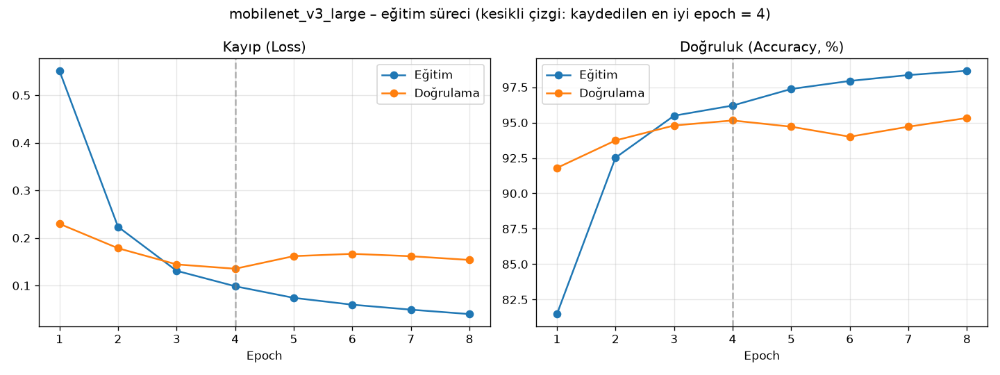
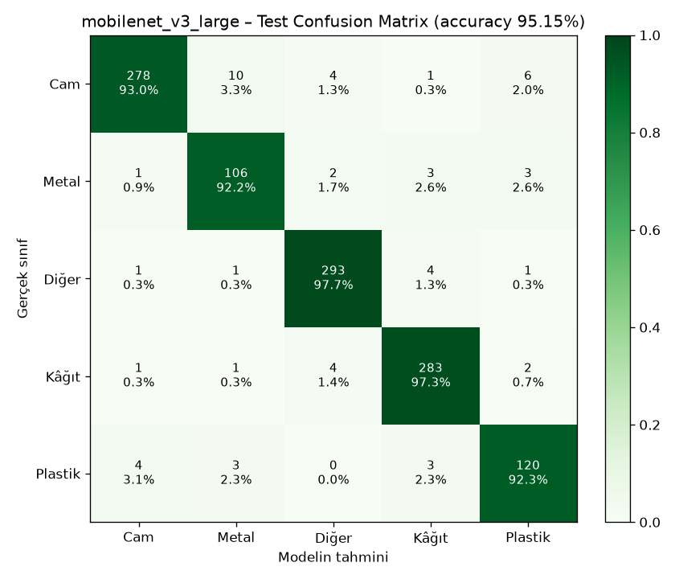

# ♻️ ECO AI – Akıllı Geri Dönüşüm Asistanı

**Yapay zekâ destekli atık sınıflandırma sistemi.** Bir atığın fotoğrafını yükleyin; kendi eğittiğimiz
derin öğrenme modeli atığın **plastik, kâğıt, metal veya cam** olduğunu tahmin etsin ve sizi doğru
geri dönüşüm kutusuna yönlendirsin.

> Yapay Zekâ dersi dönem projesi. Tamamen yerel çalışır; ücretli bir API veya servis kullanılmaz.

| | |
|---|---|
| **Model** | MobileNetV3-Large (PyTorch, transfer learning) |
| **Test doğruluğu** | **%95,15** (1.135 test görseli) |
| **Macro F1** | **%94,11** |
| **Kategoriler** | Plastik · Kâğıt · Metal · Cam (+ "diğer" reddetme sınıfı) |

---

## İçindekiler

1. [Hızlı Başlangıç (Windows / Mac)](#-hızlı-başlangıç)
2. [Kullanılan Teknolojiler](#-kullanılan-teknolojiler)
3. [Mimari](#-mimari)
4. [Veri Seti](#-veri-seti)
5. [Model Eğitimi](#-model-eğitimi)
6. [Model Performansı](#-model-performansı)
7. [Bilinmeyen Nesne Kontrolü](#-bilinmeyen-nesne-out-of-distribution-kontrolü)
8. [API Dokümantasyonu](#-api-dokümantasyonu)
9. [Manuel Kurulum (Geliştiriciler İçin)](#-manuel-kurulum-geliştiriciler-için)
10. [Testler](#-testler)
11. [Proje Yapısı](#-proje-yapısı)
12. [Bilinen Sınırlamalar](#-bilinen-sınırlamalar)
13. [Sorun Giderme](#-sorun-giderme)

---

## 🚀 Hızlı Başlangıç

Uygulamayı **çalıştırmak için modeli eğitmenize veya veri setini indirmenize gerek yoktur**;
eğitilmiş model (`backend/weights/eco_ai_model.pth`) repoda hazır gelir.

### Gerekenler (bir kez kurulur, hepsi ücretsiz)

| Araç | İndirme | Not |
|---|---|---|
| **Python 3.12** | https://www.python.org/downloads/ | ⚠️ Windows'ta kurulum ekranında **"Add python.exe to PATH"** kutusunu işaretleyin |
| **Node.js (LTS)** | https://nodejs.org | |
| **Git** | https://git-scm.com/downloads | |

### 🪟 Windows

```bat
git clone https://github.com/hasangumus0707/eco-ai.git
cd eco-ai
```

1. `eco-ai` klasöründe **`kurulum.bat`** dosyasına çift tıklayın. İlk kurulum 5–10 dakika sürer (PyTorch büyük bir paket).
2. **`baslat.bat`** dosyasına çift tıklayın. İki siyah pencere açılır (Backend ve Frontend), tarayıcı da otomatik olarak açılır.
3. Tarayıcı açılmazsa adres çubuğuna şunu yazın: **http://localhost:5173**

Kapatmak için açılan iki siyah pencereyi kapatın.

### 🍎 macOS / Linux

```bash
git clone https://github.com/hasangumus0707/eco-ai.git
cd eco-ai
./kurulum.sh      # yalnızca ilk sefer
./baslat.sh       # her seferinde (durdurmak için Ctrl+C)
```

### Güncel sürümü almak

```bash
git pull
```
`requirements.txt` veya `package.json` değiştiyse kurulum scriptini yeniden çalıştırın.

---

## 🛠 Kullanılan Teknolojiler

| Katman | Teknolojiler |
|---|---|
| **Yapay zekâ** | PyTorch 2.15, Torchvision, MobileNetV3-Large / ResNet18, scikit-learn (metrikler), Matplotlib (grafikler) |
| **Backend** | Python 3.12, FastAPI, Uvicorn, Pillow |
| **Frontend** | React 19, TypeScript (strict), Vite, Tailwind CSS 4, Recharts, Lucide Icons, React Router |
| **Donanım** | Apple Silicon GPU (MPS) → NVIDIA (CUDA) → CPU, otomatik seçilir |

---

## 🏗 Mimari

```
┌──────────────────────────┐   POST /predict    ┌──────────────────────────┐        ┌───────────────────────┐
│  Frontend (React)        │  ── fotoğraf ───▶  │  Backend (FastAPI)       │ ─────▶ │  PyTorch modeli       │
│  localhost:5173          │                    │  localhost:8000          │        │  eco_ai_model.pth     │
│  • yükleme / kamera      │  ◀──── JSON ─────  │  • dosya doğrulama       │ ◀───── │  MobileNetV3 (5 sınıf)│
│  • sonuç + grafik        │                    │  • ön işleme (224×224)   │        └───────────────────────┘
│  • geçmiş (LocalStorage) │                    │  • karar kuralı (eşik)   │
└──────────────────────────┘                    │  • kutu rengi (JSON)     │
                                                └──────────────────────────┘
```

- Model, backend açılırken **bir kez** belleğe yüklenir.
- Yüklenen görseller **diske yazılmaz**; yalnızca bellekte işlenir.
- Eğitimdeki ön işleme kodu ile tahmindeki ön işleme kodu **aynı dosyadan** gelir (`app/utils/transforms.py`).

---

## 📊 Veri Seti

**[Garbage Classification (12 classes)](https://www.kaggle.com/datasets/mostafaabla/garbage-classification)**, Kaggle (`mostafaabla`)
- **Lisans:** Veritabanı: Open Database License (ODbL) · Görseller: © orijinal sahipleri
- Görseller telif nedeniyle repoda **bulunmaz**. Yalnızca modeli yeniden eğitmek isteyenlerin indirmesi gerekir.

12 orijinal sınıf 5 sınıfa dönüştürüldü:

| Orijinal | → Bizim sınıfımız |
|---|---|
| plastic | plastic |
| metal | metal |
| paper, cardboard | paper |
| brown-glass, green-glass, white-glass | glass |
| battery, biological, clothes, shoes, trash | other (reddetme sınıfı) |

Temizlik: 16 birebir kopya ve 6 çelişkili etiketli görsel atıldı. "other" sınıfı, kaynak başına 400 görselle dengelendi.

| | Train | Val | Test | Toplam |
|---|---:|---:|---:|---:|
| Görsel | 5.296 | 1.134 | 1.135 | **7.565** |

Ayrıntılar: [`dataset/README.md`](dataset/README.md)

---

## 🧠 Model Eğitimi

> Bu adımlar yalnızca modeli **yeniden eğitmek** için gereklidir.

```bash
cd backend
source .venv/bin/activate                 # Windows: .venv\Scripts\activate
pip install -r requirements-train.txt

# 1) Veri setini Kaggle'dan indirip dataset/raw/ içine açın, sonra:
python -m training.prepare_dataset        # 12 → 5 sınıf, temizlik, train/val/test bölme

# 2) Eğitim
python -m training.train --arch mobilenet_v3_large
python -m training.train --arch resnet18

# 3) Test kümesinde değerlendirme
python -m training.evaluate --arch mobilenet_v3_large
python -m training.evaluate --arch resnet18

# 4) Seçilen modeli uygulamaya ver (weights/eco_ai_model.pth + model_config.json)
python -m training.evaluate --arch mobilenet_v3_large --deploy
```

**Eğitim ayarları:** 224×224 giriş, ImageNet normalizasyonu, AdamW (gövde lr=1e-4, kafa lr=1e-3, weight decay=1e-4),
cosine öğrenme hızı, sınıf ağırlıklı cross-entropy, batch 32, en fazla 15 epoch.

**Aşırı öğrenmeye (overfitting) karşı alınan önlemler:** data augmentation (rastgele kırpma, çevirme, ±15° döndürme, renk değişimi),
dropout, weight decay, gövde için düşük öğrenme hızı, early stopping (sabır = 4), en iyi doğrulama epoch'unun kaydedilmesi.

MacBook Air M3 (MPS) üzerinde eğitim süreleri: MobileNetV3 **5,9 dk**, ResNet18 **12,7 dk**.

---

## 📈 Model Performansı

Bütün değerler, modelin eğitim boyunca **hiç görmediği 1.135 test görselinde** ölçülmüştür.

### Model karşılaştırması

| Model | Accuracy | Macro Precision | Macro Recall | Macro F1 | "Diğer"i atık sanma | Boyut | Parametre |
|---|---:|---:|---:|---:|---:|---:|---:|
| **MobileNetV3-Large** ✅ | **95,15%** | 93,80% | 94,48% | **94,11%** | **0,3%** | **17 MB** | 4,2 M |
| ResNet18 | 94,98% | 94,11% | 93,97% | 94,03% | 2,0% | 45 MB | 11,2 M |

**MobileNetV3 seçildi:** Doğrulukta iki model fiilen eşit, ama MobileNetV3 atık olmayan nesneleri reddetmede belirgin şekilde
daha iyi ve 2,6 kat daha küçük.

### MobileNetV3: sınıf bazında sonuçlar

| Sınıf | Precision | Recall | F1 | Test görseli |
|---|---:|---:|---:|---:|
| Cam (glass) | 97,54% | 92,98% | 95,21% | 299 |
| Metal | 87,60% | 92,17% | 89,83% | 115 |
| Diğer (other) | 96,70% | 97,67% | 97,18% | 300 |
| Kâğıt (paper) | 96,26% | 97,25% | 96,75% | 291 |
| Plastik (plastic) | 90,91% | 92,31% | 91,60% | 130 |

En sık hata: 10 cam görseli metal olarak tahmin edildi (ikisi de parlak, yansımalı yüzeyler).

### Grafikler

| Eğitim süreci | Confusion Matrix |
|---|---|
|  |  |

Ham sonuçlar: `backend/reports/<model>/metrics.json` ve `classification_report.txt`.

---

## 🛡 Bilinmeyen Nesne (Out-of-Distribution) Kontrolü

Softmax olasılıklarının toplamı her zaman 1'dir. Bu yüzden model, hiç görmediği bir nesne için bile
"%90 metal" diyebilir. **Yüksek güven skoru, görselin gerçekten atık olduğunu kanıtlamaz.**
Bu riske karşı iki katmanlı bir kontrol uygulanır (`backend/app/utils/decision.py`):

1. **"other" sınıfı:** Model kıyafet, ayakkabı, yemek artığı, pil ve karışık çöp görselleriyle eğitildi.
   En yüksek olasılık "other" ise sonuç geçersiz sayılır ("atık tespit edilmedi").
2. **Güven eşiği = 0,823:** Eşik elle seçilmedi. Doğrulama kümesinde doğru tahmin edilen atık görsellerinin
   %95'inin geçeceği değer olarak hesaplandı. Bu değerin altındaki tahminlerde "güvenilir şekilde sınıflandıramadım" denir
   ve kutu önerisi gösterilmez.

Test kümesindeki etkisi:

| Ölçüm | Değer |
|---|---:|
| Gerçek atıklara kesin sonuç verme oranı | 89,7% |
| Kesin sonuçların doğruluğu | **97,6%** |
| "Diğer" görsellerini yanlışlıkla atık sanma oranı | **0,3%** (1/300) |

**Sınırları:** Testteki "diğer" görselleri, eğitimde görülen türden nesnelerdir. İnsan, araç, hayvan gibi hiç görülmemiş
nesnelerde başarı ölçülmemiştir ve daha düşük olabilir. Test sırasında küflü bir ekmek dilimi, rengi ve dokusu kartona
benzediği için **%99,9 güvenle "kâğıt"** olarak sınıflandırıldı. Bu örnek, güven skorunun neden garanti olmadığını gösterir.

---

## 🔌 API Dokümantasyonu

Backend çalışırken etkileşimli dokümantasyon: **http://localhost:8000/docs**

### `GET /health`
Backend ve model durumu. `model_sha256`, çalışan modelin gerçekten repodaki `.pth` dosyası olduğunu gösterir.
```json
{
  "status": "ok", "model_loaded": true, "model_arch": "mobilenet_v3_large",
  "model_file": "eco_ai_model.pth", "model_sha256": "ea55701c5f53",
  "device": "mps", "confidence_threshold": 0.823, "test_accuracy": 0.9515
}
```

### `GET /classes`
Desteklenen 4 kategori, kutu adı/rengi ve geri dönüşüm önerileri.

### `POST /predict`
`multipart/form-data` içinde `file` alanı (JPG / PNG / WEBP, en fazla 10 MB).

```bash
curl -X POST http://localhost:8000/predict -F "file=@sise.jpg;type=image/jpeg"
```

```json
{
  "predicted_class": "plastic",
  "predicted_class_tr": "Plastik",
  "confidence": 0.9951,
  "probabilities": { "glass": 0.0047, "metal": 0.0001, "other": 0.0, "paper": 0.0, "plastic": 0.9951 },
  "is_valid_prediction": true,
  "reason": "ok",
  "message": "Atık başarıyla sınıflandırıldı.",
  "bin_name": "Plastik atık kutusu",
  "bin_color": "Sarı",
  "bin_color_hex": "#F2C200",
  "recycling_advice": ["Şişe ve ambalajların içini tamamen boşaltın…", "…"],
  "region_note": "Kutu renkleri belediyeden belediyeye farklı olabilir…",
  "threshold": 0.823
}
```

| `reason` | Anlamı | `is_valid_prediction` |
|---|---|---|
| `ok` | Güvenilir sonuç | `true` |
| `not_recyclable` | Model "diğer" dedi | `false` |
| `low_confidence` | Güven eşiğin altında | `false` |

| HTTP kodu | Durum |
|---|---|
| 400 | Bozuk / sahte / çok küçük / desteklenmeyen görsel |
| 413 | Dosya 10 MB'tan büyük |
| 415 | Görsel olmayan dosya türü |

**Güvenlik kontrolleri:** Dosya türü uzantıdan değil **içerikten** tespit edilir. Boyut sınırı, piksel sınırı
("decompression bomb" koruması), bütünlük kontrolü ve EXIF yön düzeltmesi uygulanır. Geçici dosya oluşturulmaz.

### Kutu renklerini değiştirme
Renkler kodda değil, **`backend/app/data/recycling_config.json`** dosyasında tutulur. Varsayılan değerler
Sıfır Atık Yönetmeliği'nin önerisidir (plastik sarı, kâğıt mavi, metal gri, cam yeşil). Belediyenizin uygulaması
farklıysa bu dosyayı düzenleyin veya `ECO_AI_RECYCLING_CONFIG` ortam değişkeniyle başka bir dosya gösterin.

---

## 🔧 Manuel Kurulum (Geliştiriciler İçin)

```bash
# Backend
cd backend
python3.12 -m venv .venv
source .venv/bin/activate              # Windows: .venv\Scripts\activate
pip install -r requirements.txt        # geliştirme/eğitim için: requirements-train.txt
uvicorn app.main:app --reload          # http://localhost:8000

# Frontend (ayrı bir terminalde)
cd frontend
npm install
npm run dev                            # http://localhost:5173
```

Backend adresini değiştirmek için `frontend/.env.example` dosyasını `.env` olarak kopyalayıp `VITE_API_URL` değerini düzenleyin.

---

## ✅ Testler

```bash
cd backend
python -m pytest -v                    # 13 API testi (gerçek model ile, mock yok)
python -m training.check_device        # PyTorch + donanım kontrolü
python -m training.evaluate_real       # ornek-gorseller/ ile gerçek dünya testi

cd ../frontend
npm run build                          # TypeScript tip kontrolü + üretim derlemesi
npm run lint
```

Testlerden biri her sınıftan 10 gerçek test görselini API'ye gönderir ve en az %85 doğruluk bekler.
Eğitilmemiş veya yanlış yüklenmiş bir model bu testi geçemez.

---

## 📁 Proje Yapısı

```
eco-ai/
├── kurulum.bat / baslat.bat        # Windows: tek tıkla kurulum ve başlatma
├── kurulum.sh  / baslat.sh         # macOS / Linux
├── backend/
│   ├── app/
│   │   ├── main.py                 # FastAPI uygulaması, model yükleme (lifespan)
│   │   ├── config.py               # ayarlar ve sınırlar
│   │   ├── routes/                 # /predict, /health, /classes
│   │   ├── services/               # ModelService, RecyclingService
│   │   ├── models/classifier.py    # MobileNetV3 / ResNet18 mimarisi
│   │   ├── schemas/                # Pydantic yanıt şemaları
│   │   ├── utils/                  # transforms, decision (OOD), image_validation, device
│   │   └── data/recycling_config.json
│   ├── training/
│   │   ├── prepare_dataset.py      # 12 → 5 sınıf, temizlik, bölme
│   │   ├── dataset.py              # DataLoader, sınıf ağırlıkları
│   │   ├── train.py                # eğitim döngüsü
│   │   ├── evaluate.py             # metrikler, confusion matrix, eşik, deploy
│   │   ├── evaluate_real.py        # gerçek dünya testi
│   │   └── check_device.py
│   ├── weights/                    # eco_ai_model.pth + model_config.json
│   ├── reports/                    # grafikler ve metrikler
│   ├── tests/test_api.py
│   ├── requirements.txt            # çalıştırma
│   └── requirements-train.txt      # eğitim + test
├── frontend/
│   └── src/
│       ├── pages/                  # Ana Sayfa, Analiz, Geçmiş, Nasıl Çalışır, Hakkında
│       ├── components/             # layout, analyze, charts, ui
│       ├── services/               # api.ts, historyStore.ts
│       ├── hooks/                  # useCamera, useHistory, useTheme, useBackendHealth
│       ├── types/ data/ utils/
├── dataset/                        # README + stats.json (görseller git'te yok)
├── ornek-gorseller/                # gerçek dünya testi + demo fotoğrafları
└── docs/sunum/SUNUM.md             # sunum içeriği
```

---

## ⚠️ Bilinen Sınırlamalar

1. **Veri dağılımı farkı:** Eğitim görselleri çoğunlukla internetten toplanmış, sade arka planlı ürün fotoğraflarıdır.
   Evde çekilmiş, karışık arka planlı, ezilmiş veya kirli atık fotoğraflarında başarı düşebilir.
2. **Plastik ve metal en zayıf sınıflar** (~%92 recall). Bu sınıflarda en az eğitim görseli vardı (863 ve 768).
   Parlak pet şişeler metal veya cam ile karıştırılabilir.
3. **Hiç görülmemiş nesneler:** İnsan, araç, hayvan gibi nesneler eğitimde yoktu. "Diğer" sınıfı ve güven eşiği bunları
   çoğu zaman yakalar ama garanti veremez.
4. **Tek nesne varsayımı:** Fotoğrafta birden fazla atık varsa model tek bir kategori döndürür.
5. **Yalnızca 4 kategori:** Pil, elektronik ve organik atıklar için yönlendirme yapılmaz.
6. **Kutu renkleri yereldir:** Varsayılan renkler Sıfır Atık Yönetmeliği önerisidir; belediyeye göre değişebilir.
7. **Kamera:** Tarayıcılar kamerayı yalnızca `localhost` veya `https` üzerinden açar. Telefonla yerel ağ IP'si üzerinden
   girildiğinde tarayıcı içi kamera yerine telefonun kamera uygulaması açılır.
8. **Analiz geçmişi** yalnızca kullanılan tarayıcıda (LocalStorage) saklanır; cihazlar arasında paylaşılmaz.

---

## 🩺 Sorun Giderme

| Sorun | Çözüm |
|---|---|
| `'python' is not recognized` (Windows) | Python'u yeniden kurun ve **"Add python.exe to PATH"** kutusunu işaretleyin. |
| Arayüzde "Yapay zekâ sunucusuna bağlanılamadı" | Backend penceresi açık mı? http://localhost:8000/health adresini tarayıcıda açıp kontrol edin. |
| `Port 5173 is already in use` | Uygulama zaten açık olabilir; önceki pencereleri kapatın. |
| `Address already in use` (8000) | Önceki backend penceresini kapatın. |
| Kamera açılmıyor | Tarayıcının adres çubuğundaki kamera simgesinden izin verin; başka bir uygulama kamerayı kullanıyorsa kapatın. |
| `model_config.json bulunamadı` | `git pull` yapın; `backend/weights/` klasöründe `eco_ai_model.pth` ve `model_config.json` olmalı. |
| PowerShell'de `.venv\Scripts\activate` hata veriyor | `kurulum.bat` / `baslat.bat` kullanın (cmd ile çalışırlar) veya `Set-ExecutionPolicy -Scope CurrentUser RemoteSigned` çalıştırın. |

---

## 📜 Lisans ve Atıf

- Kaynak kod: eğitim amaçlı dönem projesi.
- Veri seti: [Garbage Classification](https://www.kaggle.com/datasets/mostafaabla/garbage-classification), Mostafa Mohamed, ODbL (veritabanı), görseller © orijinal sahipleri.
- Önceden eğitilmiş ağırlıklar: [Torchvision](https://pytorch.org/vision/stable/models.html), ImageNet-1K.
