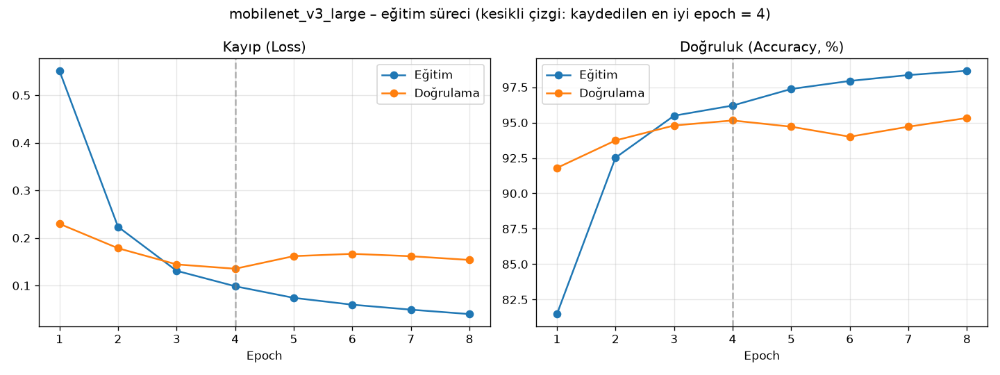
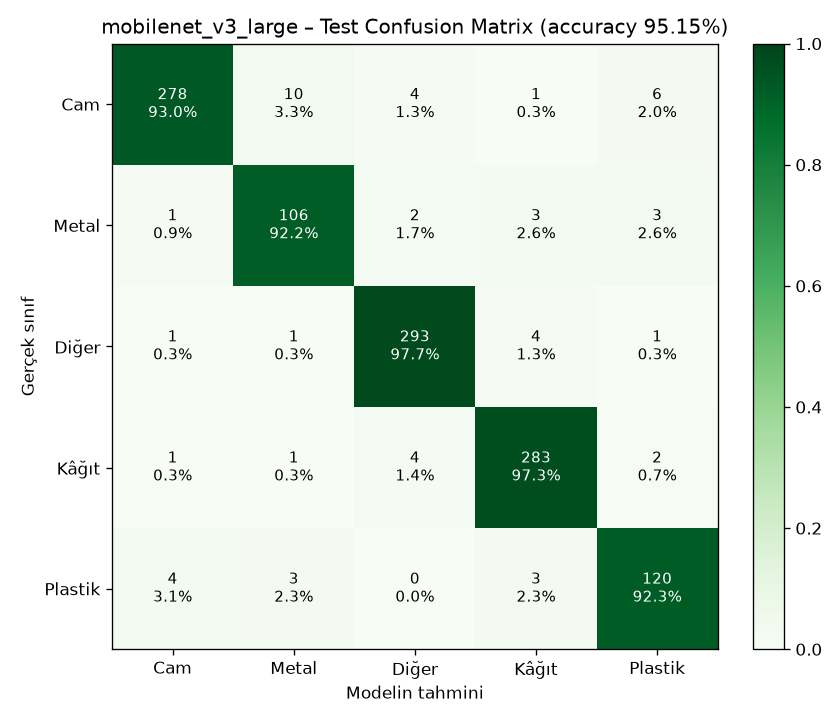

# ECO AI – Sunum İçeriği

> Bu dosya, sunumu yapacak arkadaşlar için hazırlandı. Her başlık **bir slayt** (veya iki) olarak düşünülmüştür.
> - **Slayt** kısmı: slayta yazılacak kısa maddeler.
> - **🎤 Konuşma notu** kısmı: o slaytta sözlü olarak anlatılacaklar.
>
> Bütün sayılar gerçek ölçümlerdir. Kaynakları: `backend/reports/` ve `dataset/stats.json`.
> **Sunumda bu sayıların dışında başarı oranı söylemeyin.**

**Önerilen süre:** ~12–15 dakika + sorular · **Önerilen paylaşım:** Sunucu A → 1–5, Sunucu B → 6–10

---

## 1. Projenin Amacı

**Slayt**
- ECO AI – Akıllı Geri Dönüşüm Asistanı
- Atık fotoğrafından **kategori tahmini**: Plastik · Kâğıt · Metal · Cam
- Kullanıcıyı **doğru geri dönüşüm kutusuna** yönlendirme
- Gerçek, kendi eğittiğimiz bir derin öğrenme modeli; ücretli API yok

**🎤 Konuşma notu**
Projemizin amacı, insanların "bu atık hangi kutuya gider?" sorusunu bir fotoğrafla cevaplamak. Kullanıcı bir fotoğraf
yüklüyor veya kamerayla çekiyor. Bizim eğittiğimiz yapay zekâ modeli atığın türünü tahmin ediyor ve hangi kutuya
atılacağını söylüyor. Önemli bir nokta: hazır bir yapay zekâ servisi (ChatGPT vb.) kullanmadık. Modeli PyTorch ile
kendimiz eğittik ve sistem tamamen bizim bilgisayarımızda, internet olmadan çalışıyor.

---

## 2. Çözdüğü Problem

**Slayt**
- İnsanlar atığın hangi kutuya gideceğinden çoğu zaman emin değil
- Yanlış kutuya atılan atık → geri dönüşüm akışının **kirlenmesi**
- Kutu renkleri ve kurallar **belediyeden belediyeye farklı**
- Çözüm: anında, kolay, görsel tabanlı yönlendirme

**🎤 Konuşma notu**
Geri dönüşümde en büyük sorunlardan biri kaynağında yanlış ayrıştırmadır. Mesela plastik kutusuna yemek bulaşmış bir
karton atılınca o grup kirlenebiliyor. İnsanlar çoğu zaman kararsız kalıyor. ECO AI bu kararı kolaylaştırıyor. Ayrıca
kutu renklerini koda gömmedik, bir ayar dosyasında tutuyoruz. Varsayılan olarak Sıfır Atık Yönetmeliği'nin önerdiği
renkleri kullanıyoruz ama her belediye kendi renklerine göre değiştirebilir.

---

## 3. Kullanılan Yapay Zekâ Algoritması

**Slayt**
- **Evrişimli Sinir Ağı (CNN)**: görüntü tanımanın standart yöntemi
- İki mimari denendi: **MobileNetV3-Large** ve **ResNet18**
- Seçilen: **MobileNetV3-Large** (4,2 milyon parametre, 17 MB)
- Çıkış: 5 sınıf → Plastik, Kâğıt, Metal, Cam, **Diğer**

| Model | Test doğruluğu | F1 | "Diğer"i atık sanma | Boyut |
|---|---:|---:|---:|---:|
| **MobileNetV3** ✅ | **%95,15** | %94,11 | **%0,3** | **17 MB** |
| ResNet18 | %94,98 | %94,03 | %2,0 | 45 MB |

**🎤 Konuşma notu**
CNN, görüntüyü katman katman inceleyen bir sinir ağı. İlk katmanlar kenarları ve renkleri, orta katmanlar dokuları ve
şekilleri, son katmanlar da bütün nesneyi tanıyor. İki farklı mimariyi aynı veriyle eğitip karşılaştırdık. Doğrulukları
neredeyse aynı çıktı (fark sadece 2 görsel). MobileNetV3'ü seçtik, çünkü atık olmayan nesneleri reddetmede çok daha
başarılıydı (%0,3'e karşı %2) ve 2,6 kat daha küçük. Ayrıca 4 kategoriye ek olarak bir **"Diğer"** sınıfı ekledik. Bunu
güvenilirlik bölümünde anlatacağız.

---

## 4. Transfer Learning Nedir?

**Slayt**
- Sıfırdan eğitim: milyonlarca görsel + günlerce GPU
- Transfer learning: **ImageNet** (1,2 milyon görsel, 1000 sınıf) üzerinde önceden eğitilmiş modeli al
- Son katmanı (1000 sınıf) çıkar → **5 sınıflı yeni katman** ekle
- Tüm ağı kendi verimizle kısa süre **ince ayar (fine-tuning)**
- Sonuç: 7.565 görselle, dizüstü bilgisayarda **6 dakikada** %95 doğruluk

**🎤 Konuşma notu**
Bunu bir benzetmeyle anlatabiliriz: bisiklet sürmeyi bilen biri motosikleti, hiç bilmeyen birine göre çok daha hızlı
öğrenir. Önceden eğitilmiş model "görmeyi" zaten biliyor: kenar, doku, şekil gibi şeyleri tanıyor. Biz ona sadece
"atıkları ayırt etmeyi" öğrettik. Modelin önceki bilgisini bozmamak için gövdesini 10 kat daha yavaş, yeni eklediğimiz
son katmanı ise daha hızlı eğittik. Bu sayede MacBook Air'de 6 dakikalık bir eğitim yetti.

---

## 5. Kullanılan Veri Seti

**Slayt**
- Kaggle **Garbage Classification (12 classes)**, 15.515 görsel
- Lisans: ODbL (veritabanı) · görseller © orijinal sahipleri
- 12 sınıf → bizim 5 sınıfımız:
  - kâğıt + **karton** → Kâğıt
  - kahverengi + yeşil + beyaz **cam** → Cam
  - pil, yemek, kıyafet, ayakkabı, çöp → **Diğer**
- Temizlik: 16 kopya + 6 çelişkili etiketli görsel atıldı
- Son durum: **7.565 görsel** → 5.296 eğitim / 1.134 doğrulama / 1.135 test

**🎤 Konuşma notu**
Veri setimiz bizim 4 kategorimizle birebir örtüşmüyordu, bu yüzden uyarladık. Kartonu kâğıtla birleştirdik, çünkü aynı
geri dönüşüm akışına gidiyorlar. Üç renk camı tek bir cam sınıfında topladık. Geri dönüşmeyen nesneleri "Diğer" sınıfına
koyduk. Veriyi incelerken aynı fotoğrafın birden fazla kez bulunduğunu fark ettik. Bunları temizledik, çünkü aynı görsel
hem eğitim hem test kümesine düşerse başarı olduğundan yüksek çıkar. Buna **veri sızıntısı** denir. Veriyi üçe böldük.
Test kümesi eğitim bitene kadar modele hiç gösterilmedi.

*(İsteğe bağlı görsel: `dataset/README.md` içindeki dağılım tablosu)*

---

## 6. Modelin Eğitim Süreci

**Slayt**
- Ön işleme: 224×224 boyut + normalizasyon
- **Data augmentation**: rastgele kırpma, çevirme, döndürme, ışık değişimi
- Dengesiz sınıflar için **sınıf ağırlıklı kayıp fonksiyonu**
- Overfitting önlemleri: dropout, weight decay, **early stopping**
- Donanım: Apple M3 GPU (MPS), 5,9 dakika



**🎤 Konuşma notu**
Grafikte mavi çizgi eğitim, turuncu çizgi doğrulama sonucunu gösteriyor. Dikkat edin: 4. epoch'tan sonra eğitim
başarısı artmaya devam ediyor ama doğrulama başarısı artık iyileşmiyor, hatta kayıp yükseliyor. Bu, modelin ezberlemeye
başladığının işareti. Buna **overfitting** (aşırı öğrenme) denir. Kurduğumuz **early stopping** mekanizması bunu
yakaladı, eğitimi durdurdu ve 4. epoch'taki en iyi modeli sakladı. Ayrıca metal ve plastikte diğer sınıfların yarısı
kadar görsel vardı. Model bu sınıfları ihmal etmesin diye, bu sınıflardaki hataları daha ağır cezalandırdık.

---

## 7. Modelin Başarı Oranı

**Slayt**
- 1.135 test görseli (eğitimde hiç görülmedi)
- **Accuracy: %95,15** · Precision: %93,80 · Recall: %94,48 · **F1: %94,11**
- En iyi: Diğer (%97,7), Kâğıt (%97,3) · En zor: Metal (%92,2), Plastik (%92,3)
- En sık hata: **cam → metal** (parlak yüzeyler)



**🎤 Konuşma notu**
Confusion matrix'te satırlar gerçek sınıfı, sütunlar modelin tahminini gösteriyor. Köşegendeki koyu yeşil kutular doğru
tahminler. En sık hata 10 cam görselinin metal sanılması. İkisi de parlak ve yansıtıcı olduğu için anlaşılır bir hata.
Metal ve plastik, en az görsele sahip sınıflar oldukları için en düşük başarıyı aldı.

**Metriklerin kısa anlamı** (hoca sorarsa):
- **Accuracy:** tüm tahminlerin yüzde kaçı doğru.
- **Precision:** model "plastik" dediğinde yüzde kaç gerçekten plastik.
- **Recall:** gerçek plastiklerin yüzde kaçını yakaladı.
- **F1:** precision ile recall'un dengeli ortalaması.

---

## 8. Web Uygulamasının Çalışma Mantığı

**Slayt**
```
Tarayıcı (React)  →  FastAPI backend  →  PyTorch modeli
   fotoğraf          doğrulama +          5 sınıf olasılığı
                     ön işleme            ↓
   sonuç  ←──────  karar kuralı + kutu rengi
```
- **Güvenilirlik katmanı** (önemli!):
  1. Model "Diğer" derse → "atık tespit edilmedi"
  2. Güven < **%82,3** → "güvenilir şekilde sınıflandıramadım"
- Etkisi: kesin sonuçların **%97,6'sı doğru**, atık olmayanların yalnızca **%0,3'ü** atık sanıldı
- Güvenlik: dosya içerik kontrolü, 10 MB sınırı, diske kayıt yok

**🎤 Konuşma notu**
Kullanıcı fotoğrafı yüklüyor, backend önce dosyanın gerçekten bir görsel olduğunu kontrol ediyor. Uzantıya değil,
dosyanın içeriğine bakıyor. Sonra görsel modele veriliyor ve model her sınıf için bir olasılık döndürüyor.

Burada önemli bir nokta var: model her zaman bir cevap verir. Bir araba fotoğrafı için bile "%70 metal" diyebilir.
**Yüksek güven skoru, görselin gerçekten atık olduğunu kanıtlamaz.** Bu yüzden iki kontrol ekledik. Birincisi "Diğer"
sınıfı: modele kıyafet, yemek, pil gibi şeyleri göstererek "bunlar atık kategorisi değil" demeyi öğrettik. İkincisi güven
eşiği: model %82,3'ün altında eminse kesin sonuç göstermiyoruz. Bu eşiği elle seçmedik, doğrulama verisinden
hesapladık. Sonuçta sistem bazen "emin değilim" diyor, ama söylediği kesin sonuçların %97,6'sı doğru.

---

## 9. Gerçek Uygulama Demosu

**Demo senaryosu (~3 dk)**: aşağıdaki sırayı takip edin.

1. **Ana sayfa:** Başlığı ve kategorileri gösterin. "Modelimiz Rakamlarla" bölümündeki değerlerin gerçek test sonuçları
   olduğunu söyleyin.
2. **Analiz Et** sayfası: Üstteki yeşil rozeti gösterin: *"Model hazır: mobilenet_v3_large · #ea55701c5f53"*. Bu, gerçek
   model dosyasının parmak izi.
3. **Plastik şişe** fotoğrafı yükleyin (`ornek-gorseller/plastic/`) → sonuç, güven skoru, olasılık grafiği, kutu önerisi.
4. **Kamerayla Çek:** Elinizdeki bir kola kutusunu veya kâğıdı canlı çekin.
5. **Atık olmayan bir şey** gösterin (kendi yüzünüz, bir ayakkabı vb.) → "Geri dönüştürülebilir atık tespit edilmedi"
   veya "güvenilir sonuç verilemedi" mesajını gösterin. **Bu, sistemin en güçlü yanı; mutlaka gösterin.**
6. **Geçmiş** sayfası: yapılan analizler, günlük sayaç, kategori grafiği.
7. (İsteğe bağlı) Sağ üstten **karanlık mod**.

**Demo öncesi kontrol listesi**
- [ ] Sunumdan **bir gün önce** `git pull` + `baslat.bat` ile prova yapıldı
- [ ] Bilgisayar şarjda, uyku modu kapalı
- [ ] `ornek-gorseller/` klasöründe yedek fotoğraflar var (kamera çalışmazsa)
- [ ] Tarayıcı kamera izni önceden verildi
- [ ] Demo sırasında internet gerekmez, ama kurulum için gerekir: kurulumu önceden yapın

⚠️ **Model bir demo fotoğrafında yanılırsa panik yapmayın.** Bunu fırsata çevirin: "Gördüğünüz gibi model emin
olmadığında kesin sonuç göstermiyor, güvenlik katmanımız tam olarak bunun için var" diyebilirsiniz.

---

## 10. Gelecekte Geliştirilebilecek Özellikler

**Slayt**
- **Gerçek dünya verisi:** Kendi çektiğimiz fotoğraflarla modeli güçlendirmek
- **Daha fazla kategori:** pil, elektronik, organik atık
- **Nesne tespiti (YOLO):** tek fotoğrafta birden fazla atığı bulmak
- **Konuma göre kutu rengi:** belediye seçimi
- **Mobil uygulama / çevrimdışı model** (ONNX, Core ML)
- Daha gelişmiş bilinmeyen nesne tespiti (enerji skoru, Mahalanobis mesafesi)

**🎤 Konuşma notu**
Şu anki en büyük sınırlamamız, eğitim görsellerinin internetten toplanmış temiz ürün fotoğrafları olması. Evde çekilmiş
karışık arka planlı fotoğraflarda başarı düşebilir. Bunu çözmenin en etkili yolu kendi fotoğraflarımızla veri setini
büyütmek. Ayrıca şu an model fotoğraftaki tek bir nesneyi sınıflandırıyor. YOLO gibi bir nesne tespit modeliyle aynı
fotoğraftaki birden fazla atığı ayrı ayrı bulabiliriz.

---

## Ek: Hocanın Sorabileceği Sorular

**S: Hazır bir API mi kullandınız?**
C: Hayır. Modeli PyTorch ile kendimiz eğittik. Eğitilmiş model dosyası `backend/weights/eco_ai_model.pth` (17 MB).
Backend açılırken bu dosyayı yüklüyor. `/health` adresi dosyanın parmak izini (sha256) gösteriyor. İnternet bağlantısı
olmadan çalışıyor.

**S: %95 doğruluk gerçek hayatta da geçerli mi?**
C: Hayır, ve bunu dürüstçe belirtiyoruz. %95, veri setinin test kümesinde ölçüldü. Bu görseller eğitim görselleriyle
benzer türde, temiz arka planlı fotoğraflar. Gerçek hayatta başarı daha düşük olabilir. Bunun için ayrı bir gerçek
dünya testi hazırladık (`ornek-gorseller/`, `training/evaluate_real.py`).
*(Gerçek dünya testi yapıldıysa sonucunu buraya ekleyin: `backend/reports/real_world/results.md`)*

**S: Model hiç görmediği bir şey gelirse ne olur?**
C: Softmax her zaman bir cevap verir, bu yüzden iki önlem aldık: "Diğer" sınıfı ve doğrulama verisinden hesaplanan
güven eşiği. Ama bu bir garanti değil. Örneğin test sırasında küflü bir ekmek dilimi, rengi ve dokusu kartona benzediği
için %99,9 güvenle kâğıt sanıldı. Bu, güven skorunun neden kanıt olmadığını gösteren güzel bir örnek.

**S: Neden ResNet18 değil de MobileNetV3?**
C: Doğrulukları fiilen eşitti (%95,15'e karşı %94,98). MobileNetV3 atık olmayan nesneleri daha iyi reddetti (%0,3'e karşı
%2), 2,6 kat daha küçüktü ve daha kısa sürede eğitildi.

**S: Overfitting olmadığını nasıl biliyorsunuz?**
C: Eğitim ve doğrulama eğrilerini izledik. 4. epoch'tan sonra doğrulama kaybı yükselmeye başladı, early stopping eğitimi
durdurdu ve en iyi epoch'u sakladı. Ayrıca test kümesi eğitimde hiç kullanılmadı. Test sonucunun (%95,15) doğrulama
sonucuyla (%95,15) aynı çıkması da modelin ezberlemediğini gösteriyor.

**S: Veri setindeki dengesizliği nasıl çözdünüz?**
C: İki yolla. "Diğer" sınıfında çok fazla kıyafet görseli vardı (5.325), kaynak başına 400 görselle sınırladık. Metal
ve plastik az görsele sahipti, kayıp fonksiyonunda bu sınıflara daha yüksek ağırlık verdik (metal 1,97 · plastik 1,75 ·
diğerleri ~0,77).

**S: Güven eşiği neden 0,823?**
C: Doğrulama kümesinde doğru sınıflandırılan atık görsellerinin %95'inin bu eşiği geçmesini sağlayan değer. Yani elle
seçilmedi, veriden hesaplandı. Eşik yükselirse yanlış sonuç azalır ama sistem daha sık "emin değilim" der. Bu bir
ödünleşim (trade-off).

**S: Karton neden kâğıt sınıfında?**
C: Türkiye'deki uygulamada kâğıt ve karton aynı geri dönüşüm akışına gidiyor. Veri setinde ayrıydılar, biz bilinçli
olarak birleştirdik ve bunu belgeledik.
